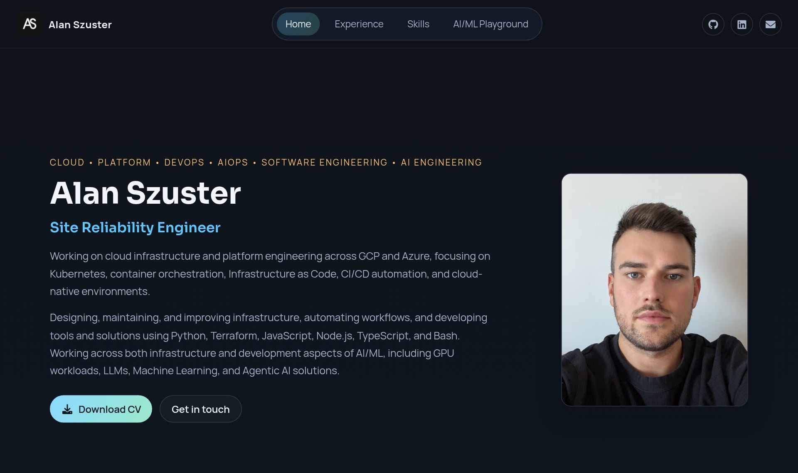

# Alan Szuster - Personal Website

**Live:** [www.alanszuster.dev](https://www.alanszuster.dev)

Personal portfolio website with a live AI playground :)

<p align="center">
  
</p>

## How it works

- **Site:** a Next.js app (TypeScript) with Home, Experience, Skills and an AI/ML Playground section.
- **AI Playground:** you draw on a canvas, the sketch is cropped and redrawn to match the model's training data and sent to the site's own API routes, which call [doodleai](https://github.com/alanszuster/doodleai) server-side. Credentials never reach the browser: Vercel issues short-lived tokens, so there is no shared secret to store. The playground also shows whether the API is up and which version is running.
- **Abuse protection:** rate limiting and bot detection at the edge, input validation in the API routes.
- **Delivery:** GitHub Actions runs lint, type check, tests and a dependency audit; `main` deploys to Vercel.

## Tech stack

- Next.js, React, TypeScript, CSS Modules
- Jest, React Testing Library, ESLint
- Vercel, GitHub Actions
- Node.js 26 (LTS)

## Development

```bash
npm install
npm run dev
npm test
```

## License

© 2025 Alan Szuster. All rights reserved.
